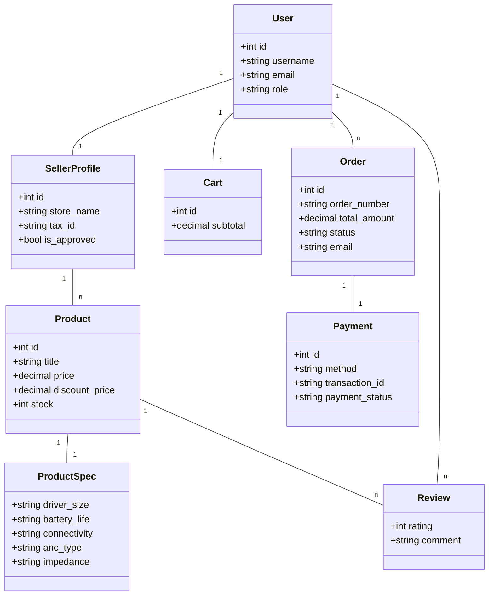

# Software Requirements Specification (SRS)
## SoundSphere – Modern Headphone & Audio Accessories E-Commerce Platform

---

### Document Header
**Project Title:** SoundSphere – Modern Headphone & Audio Accessories E-Commerce Platform  
**Document Type:** Software Requirements Specification (SRS)  
**Technology Stack:** Python (Django 4.x/5.x), MySQL / SQLite, HTML5, CSS3, JavaScript  
**Target Audience:** Project Evaluators, Faculty Guide, Developers, System Administrators, Sellers, End Users  

---

### Revision History

| Version | Date | Description | Author |
| :---: | :---: | :--- | :---: |
| **1.0** | August 31, 2026 | Full Software Requirements Specification (SRS) for SoundSphere | Project Development Team |

---

## Table of Contents
1. [Introduction](#1-introduction)
   - 1.1 [Purpose](#11-purpose)
   - 1.2 [Document Conventions](#12-document-conventions)
   - 1.3 [Intended Audience and Reading Suggestions](#13-intended-audience-and-reading-suggestions)
   - 1.4 [Project Scope](#14-project-scope)
   - 1.5 [References](#15-references)
2. [Overall Description](#2-overall-description)
   - 2.1 [Product Perspective](#21-product-perspective)
   - 2.2 [Product Features](#22-product-features)
   - 2.3 [User Classes and Characteristics](#23-user-classes-and-characteristics)
   - 2.4 [Operating Environment](#24-operating-environment)
   - 2.5 [Design and Implementation Constraints](#25-design-and-implementation-constraints)
   - 2.6 [User Documentation](#26-user-documentation)
   - 2.7 [Assumptions and Dependencies](#27-assumptions-and-dependencies)
3. [System Features (Functional Requirements)](#3-system-features-functional-requirements)
   - 3.1 [User Authentication & Registration](#31-user-authentication--registration)
   - 3.2 [Seller Verification & Approval](#32-seller-verification--approval)
   - 3.3 [Product Management](#33-product-management)
   - 3.4 [Product Browsing & Search](#34-product-browsing--search)
   - 3.5 [Product Details & Technical Specifications](#35-product-details--technical-specifications)
   - 3.6 [Wishlist Management](#36-wishlist-management)
   - 3.7 [Shopping Cart Management](#37-shopping-cart-management)
   - 3.8 [Order Placement & Checkout](#38-order-placement--checkout)
   - 3.9 [Online Payment](#39-online-payment)
   - 3.10 [Delivery Location & Order Tracking](#310-delivery-location--order-tracking)
   - 3.11 [Product Reviews & Ratings](#311-product-reviews--ratings)
   - 3.12 [Seller Dashboard](#312-seller-dashboard)
   - 3.13 [Inventory & Stock Management](#313-inventory--stock-management)
   - 3.14 [Notifications](#314-notifications)
   - 3.15 [Admin Management & System Monitoring](#315-admin-management--system-monitoring)
   - 3.16 [Email / Order Confirmation](#316-email--order-confirmation)
4. [External Interface Requirements](#4-external-interface-requirements)
   - 4.1 [User Interfaces](#41-user-interfaces)
   - 4.2 [Hardware Interfaces](#42-hardware-interfaces)
   - 4.3 [Software Interfaces](#43-software-interfaces)
   - 4.4 [Communications Interfaces](#44-communications-interfaces)
5. [Other Nonfunctional Requirements](#5-other-nonfunctional-requirements)
   - 5.1 [Performance Requirements](#51-performance-requirements)
   - 5.2 [Safety Requirements](#52-safety-requirements)
   - 5.3 [Security Requirements](#53-security-requirements)
   - 5.4 [Software Quality Attributes](#54-software-quality-attributes)
6. [Other Requirements](#6-other-requirements)
- [Appendix A: Glossary](#appendix-a-glossary)
- [Appendix B: Analysis Models](#appendix-b-analysis-models)
- [Appendix C: Issues List](#appendix-c-issues-list)

---

## 1. Introduction

### 1.1 Purpose
The purpose of this Software Requirements Specification (SRS) document is to detail the complete functional and non-functional requirements for **SoundSphere**, a premium web-based e-commerce platform dedicated to headphones and audio accessories.  
The application is implemented using **Python Django** as the web backend framework, **MySQL** (or SQLite in development) as the database management system, and **HTML5, CSS3, and JavaScript** for a modern, glassmorphic frontend user interface.  
This document specifies system behaviors, user role permissions, database mappings, workflow models, external interfaces, and quality attributes for evaluators, developers, system administrators, sellers, and end users.

### 1.2 Document Conventions
The following conventions are used throughout this document:
SRS – Software Requirements Specification 
MCA – Master of Computer Applications 
UI – User Interface 
DB – Database 
Admin – Administrator responsible for managing the SoundSphere system 
Customer/User – Person who uses the website to browse, search, and purchase headphones and audio accessories 
Seller/Vendor – A verified brand, merchant, or distributor who lists audio products for sale 
Django – Python-based web development framework 
MySQL – Relational Database Management System 
Product – A headphone, earphone, earbud, studio monitor, or audio accessory available for purchase 
Order – A purchase request placed by a customer 
Seller Verification – Process through which an administrator reviews and approves seller store applications 
ANC – Active Noise Cancellation technology feature in headphones 
ORM – Object-Relational Mapping used by Django to interact with the database 
COD – Cash on Delivery payment option 
UPI – Unified Payments Interface payment option 
QR Code – Machine-readable code used to display payment information 
Invoice – A printable purchase receipt containing order details and transaction reference ID 

### 1.3 Intended Audience and Reading Suggestions
This document is designed for:
- **Academic Evaluators & Faculty Guides:** To review software engineering design rigor, requirements traceability, and system modeling.
- **Developers & Software Engineers:** To understand module architectures, URL routing, view logic, and ORM schema boundaries.
- **System Administrators & Store Managers:** To reference administrative controls, seller approvals, and order fulfillment workflows.

### 1.4 Project Scope
**SoundSphere** is a modern e-commerce web platform engineered specifically for high-fidelity audio equipment including wireless headphones, gaming headsets, Bluetooth earbuds, studio monitors, active noise-cancelling (ANC) headphones, and audio accessories (stands, ear cushions, carrying cases, cables).

The system supports three distinct operational user roles:
1. **Customers:** Search, filter, and view audio specs, manage address books, save wishlist items, apply promo coupons (`SOUND10`, `VIP20`), perform instant "Buy Now" or cart checkout, track live order status timelines, download printable invoice receipts, submit reviews/ratings, receive automated order confirmation emails, and send site feedback.
2. **Sellers / Vendors:** Register vendor profiles, list audio products with technical specification matrices (driver size, battery life, connectivity, impedance), manage stock inventory, monitor store sales revenue, and receive low-stock alerts.
3. **Administrators:** Control full system CRUD operations across categories, brands, products, moderate seller approvals, oversee customer feedback/inquiries, manage order fulfillment statuses (`Pending` ➔ `Processing` ➔ `Shipped` ➔ `Delivered` ➔ `Cancelled`), configure email SMTP settings, and configure hero banners.

### 1.5 References
- Python Documentation (`https://docs.python.org/3/`)
- Django Framework Documentation (`https://docs.djangoproject.com/`)
- MySQL Documentation (`https://dev.mysql.com/doc/`)
- W3C HTML5 & CSS3 Specifications
- IEEE Std 830-1998 SRS Specification Guidelines / Karl Wiegers Template

---

## 2. Overall Description

### 2.1 Product Perspective
SoundSphere operates as an independent, web-accessible client-server application adhering to a 3-tier architectural framework:

```
[ Customer / Seller / Admin Browser ]
               │
               ▼ HTTP / HTTPS
   [ Presentation Layer ] (HTML5, Glassmorphic CSS3, Vanilla JS)
               │
               ▼ Django URL Router & Views
   [ Application Layer ] (Python 3.x, Django Web Framework)
               │
               ▼ Django ORM
       [ Data Layer ] (MySQL / SQLite Relational Database)
```

**Architectural Layers:**
- **Presentation Layer:** Glassmorphic modern dark-mode aesthetic with interactive JavaScript toasts, modal overlays, dynamic cart counters, and AJAX heart toggles.
- **Application Layer:** Modular Django architecture (`accounts`, `sellers`, `products`, `wishlist`, `cart`, `orders`, `notifications`, `admin_panel`).
- **Data Layer:** Relational schemas with strict foreign key constraints between User, SellerProfile, Product, ProductSpec, Cart, CartItem, Order, OrderItem, Payment, Review, and CustomerFeedback.

### 2.2 Product Features
1. **Multi-Role Authentication & Profile Management:** Custom User Model supporting Customer, Seller, and Admin roles, shipping address book management.
2. **Seller Storefront & Portal:** Vendor registration, store profile configuration (GSTIN/Tax ID, store description), vendor dashboard analytics, product catalog listing, and sales tracking.
3. **Technical Product Catalog & Specs Matrix:** Brand filters (Sony, Bose, Sennheiser, Audio-Technica, JBL, SoundSphere), category filters, live AJAX search, technical specifications (driver size, battery life, connectivity, noise cancellation, impedance, weight).
4. **Wishlist & Favorite Items:** One-click AJAX save/remove, dynamic badge counter, direct "Move to Cart" action.
5. **Shopping Cart & Promo Coupon Engine:** Dynamic quantity updates, stock validation, auto-calculated subtotal, tax (8%), shipping, promo codes (`SOUND10`, `VIP20`).
6. **Checkout & Instant "Buy Now":** One-click "Buy Now" flow bypassing cart, saved shipping address selection, multi-method payment authorization (COD, Card, UPI/QR Code, Net Banking, Gateway placeholder).
7. **Order Tracking & Printable Invoice Receipt:** Stage-by-stage fulfillment timeline (`Pending` ➔ `Processing` ➔ `Shipped` ➔ `Delivered`), unique transaction reference numbers (`TXN-...`), clean printable invoice view.
8. **Email & Order Confirmation System:** Automated confirmation emails (`send_mail`), on-screen order summary receipts, and account notifications.
9. **Customer Product Reviews & Ratings:** Verified buyer star ratings (1–5 stars), headline, comment, dynamic product average score updates.
10. **Customer Feedback & Support Inquiry Module:** In-app inquiry form for site feedback, order help, product inquiries, admin inspection interface.
11. **Admin Control Panel:** Business metrics dashboard, low-stock warnings (Stock ≤ 5), catalog CRUD, order fulfillment status updater, hero banner control.

### 2.3 User Classes and Characteristics

#### 1. Customer / Listener
- **Description:** End user searching for and purchasing headphones and audio gear.
- **Capabilities:** Account creation, shipping address management, searching/filtering audio gear, viewing tech specs, wishlist management, cart checkout, instant Buy Now, QR/COD payment, order status tracking, printing receipts, receiving confirmation emails, reviewing products, submitting inquiries.
- **Technical Skill:** Basic web browsing experience on desktop or mobile devices.

#### 2. Seller / Audio Vendor
- **Description:** Independent merchant or brand vendor selling headphones and audio accessories.
- **Capabilities:** Vendor registration, store profile management, product listing with tech specs, inventory stock adjustments, sales tracking dashboard, low-stock tracking.
- **Technical Skill:** Basic e-commerce vendor management knowledge.

#### 3. Administrator / System Admin
- **Description:** Platform manager responsible for site-wide governance.
- **Capabilities:** System revenue oversight, user role configuration, catalog CRUD, category/brand setup, order status management (`Pending` ➔ `Delivered`), email SMTP configuration, feedback inspection, seller approvals.
- **Technical Skill:** Web administration and e-commerce platform management experience.

### 2.4 Operating Environment

| Component | Specification |
| :--- | :--- |
| **Operating System** | Windows 10/11 / Linux (Ubuntu/Debian) / macOS |
| **Frontend Technologies** | HTML5, Vanilla CSS3 (Glassmorphism), JavaScript (ES6+), FontAwesome Icons |
| **Backend Framework** | Python 3.10+ / Django 4.2+ |
| **Database Engine** | MySQL 8.0+ (Production) / SQLite3 (Development) |
| **Supported Browsers** | Google Chrome 90+, Mozilla Firefox 88+, Microsoft Edge 90+, Safari 14+ |
| **Web Server** | Gunicorn / Nginx / Django Development WSGI Server |
| **ORM Access** | Django Object-Relational Mapper (ORM) |
| **Email Protocol** | SMTP / Django `send_mail` Backend |

### 2.5 Design and Implementation Constraints
- The backend MUST be implemented in Python Django using proper MVT (Model-View-Template) conventions.
- The database MUST maintain relational integrity using MySQL/SQLite with Django ORM.
- The frontend MUST be responsive across desktop, tablet, and mobile browsers without requiring third-party CSS frameworks like Tailwind unless requested.
- Secure user authentication MUST use Django password hashing (PBKDF2 SHA-256) and CSRF tokens on all POST/PUT requests.
- System is constrained by the resource and timeline scope of an MCA mini project.

### 2.6 User Documentation
- **Customer Guide:** Contextual form validation, dynamic toast alerts (e.g. "Item added to cart"), address selector dropdowns, visual order status timeline, order confirmation email notifications.
- **Seller Guide:** Tooltips for technical spec fields (e.g. driver size in mm, battery life in hrs), clear dashboard revenue summaries.
- **Admin Guide:** Clean administrative dashboard with metrics cards, filterable order tables, and warning alert tables.

### 2.7 Assumptions and Dependencies

#### Assumptions
- Users have standard web browsers with JavaScript enabled.
- Sellers input valid technical product specs and maintain genuine inventory counts.
- Customers provide accurate shipping addresses and contact phone numbers.

#### Dependencies
- Python 3.x runtime environment
- Django web framework and core dependencies
- MySQL / SQLite database connectivity
- SMTP Server for email confirmation dispatch (configured via Django `settings.py`)

---

## 3. System Features (Functional Requirements)

The functional requirements describe what the **SoundSphere E-Commerce Platform** must do, how the different modules and users will interact with the system, and the expected services provided by the platform. These requirements ensure that the system operates efficiently and provides a secure and user-friendly online marketplace for purchasing and selling headphones and other audio products.

The SoundSphere system consists of three major user roles: **Customer, Seller, and Administrator**. Each user role has different permissions and functionalities within the system.

### 3.1 User Authentication & Registration
- **Customer:** Can create an account using personal details such as first name, last name, email address, phone number, and password. Customers can securely log in and access their personal account.
- **Seller:** Can register as a seller by providing personal details along with seller brand and store information such as brand name, tagline, brand description, business ID or tax ID, location, and optional brand logo.
- **Administrator:** Manages user and seller accounts and controls role-based access within the system. The administrator can monitor registered users and sellers.

### 3.2 Seller Verification & Approval
- **Customer:** Can view products only from sellers whose products have been approved and made available on the platform.
- **Seller:** Can submit seller and brand information for registration and wait for administrator approval before accessing seller-related features.
- **Administrator:** Reviews seller registration details and approves or rejects seller applications. Approved sellers receive access to the Seller Dashboard and can submit products for listing.

### 3.3 Product Management
- **Customer:** Can view available headphone products, including product images, descriptions, prices, technical specifications, ratings, and reviews.
- **Seller:** Can add new products by providing product information such as product title, category, brand, regular price, sale price, stock quantity, product image, comprehensive description, and technical specifications.
- **Administrator:** Monitors and manages products available on the platform and can approve, update, or remove inappropriate product listings when required.

### 3.4 Product Browsing & Search
- **Customer:** Can browse available headphones and audio products and search for products based on product name, category, brand, or other available details.
- **Seller:** Can view and manage the products submitted through the seller account.
- **Administrator:** Can monitor all products, categories, and brands available in the system.

### 3.5 Product Details & Technical Specifications
- **Customer:** Can view detailed information about a selected product, including the main product image, product description, price, stock availability, and technical specifications.
- **Seller:** Can enter and manage technical product specifications such as driver size, battery life, connectivity, noise cancellation, frequency response, impedance, weight, and warranty period.
- **Administrator:** Can monitor product information and ensure that product listings contain appropriate and complete details.

### 3.6 Wishlist Management
- **Customer:** Can add preferred products to a wishlist or favourites list and view or remove saved products later.
- **Seller:** Does not have access to customer wishlists and can only manage their own product listings.
- **Administrator:** Can monitor the overall system and manage the platform without accessing or modifying personal customer preferences unnecessarily.

### 3.7 Shopping Cart Management
- **Customer:** Can add products to the shopping cart, update product quantities, remove products, apply discount coupons, and view the total order amount before checkout.
- **Seller:** Can view orders containing their products after a customer successfully places an order.
- **Administrator:** Can monitor order activities and manage order-related information across the platform.

### 3.8 Order Placement & Checkout
- **Customer:** Can select products from the cart, provide delivery information, select a payment method, and place an order (or use instant "Buy Now").
- **Seller:** Receives information about orders placed for products belonging to their store and can manage order processing.
- **Administrator:** Can monitor orders placed across the SoundSphere platform and manage order-related issues when necessary.

### 3.9 Online Payment
- **Customer:** Can make payments for selected products using available online payment options (COD, Credit/Debit Card, UPI/QR Code, Net Banking).
- **Seller:** Can view order and payment-related information associated with products sold through the platform.
- **Administrator:** Can monitor payment and transaction status and manage payment-related records within the system.

### 3.10 Delivery Location & Order Tracking
- **Customer:** Can provide a delivery location during checkout and track the status of the placed order (`Pending` ➔ `Processing` ➔ `Shipped` ➔ `Delivered`).
- **Seller:** Can update order processing and delivery status based on the progress of the order.
- **Administrator:** Can monitor order and delivery activities across the entire platform and manage delivery-related issues.

### 3.11 Product Reviews & Ratings
- **Customer:** Can provide ratings (1-5 stars), review headlines, and feedback for products after purchasing or using them. Customers can also view reviews submitted by other users.
- **Seller:** Can view customer reviews and ratings for products listed in their store.
- **Administrator:** Can monitor reviews and remove inappropriate or misleading content when required.

### 3.12 Seller Dashboard
- **Customer:** Does not have access to seller management functions.
- **Seller:** Can access a dedicated dashboard to manage product listings, stock availability, prices, sales metrics, and order information.
- **Administrator:** Monitors seller activities and manages seller accounts through the administrative dashboard.

### 3.13 Inventory & Stock Management
- **Customer:** Can view whether a product is available or out of stock before purchasing.
- **Seller:** Can add and update available stock quantities for individual products.
- **Administrator:** Can monitor product availability and inventory information across the platform, including low-stock alerts.

### 3.14 Notifications
- **Customer:** Receives notifications related to order confirmation, payment status, order processing, and delivery updates.
- **Seller:** Receives notifications regarding seller approval, product-related activities, and new orders.
- **Administrator:** Receives notifications related to seller registration requests, product management activities, and important system events.

### 3.15 Admin Management & System Monitoring
- **Customer:** Has access only to personal account features, product browsing, wishlist, cart, orders, and reviews.
- **Seller:** Has access only to authorized seller functions, including product management and order management.
- **Administrator:** Has complete control over the SoundSphere platform, including customer accounts, seller approval, product management, orders, reviews, and overall system monitoring.

### 3.16 Email / Order Confirmation
- **Customer:** Receives instant on-screen order summary receipts (`orders/confirmation.html`), printable invoices (`orders/invoice.html`), automated order confirmation email notifications via Django `send_mail` detailing Order Number (`#...`), item breakdown, total cost, and delivery address, as well as in-app account notifications.
- **Seller:** Receives order notifications regarding orders containing their listed products.
- **Administrator:** Configures system email settings (SMTP parameters) and monitors order confirmation logs.

---

## 4. External Interface Requirements

### 4.1 User Interfaces

#### Customer Interface
- **Home Page:** Glassmorphic hero section, featured headphones carousel, category grids, brand showcase, special promo banners.
- **Catalog & Search Page:** Grid list of headphone cards, sidebar filters (Brand, Price slider, ANC, Category), live search bar with AJAX auto-complete.
- **Product Detail Page:** Multi-image gallery, tech specs matrix table, stock badge, quantity controls, "Add to Cart" button, "Buy Now" button, wishlist heart toggle, reviews section.
- **Cart Page:** Itemized table, quantity spinners, promo coupon input box, summary breakdown panel (Subtotal, Tax, Shipping, Total), checkout button.
- **Checkout Page:** Step 1 address selector modal/accordion, Step 2 payment options (COD, Card form, scannable UPI QR code display), order summary box.
- **My Orders & Tracking Page:** Order history list, visual progress tracker bar (`Pending` ➔ `Delivered`), "Print Invoice" button.
- **Order Confirmation Page & Email Receipt:** On-screen confirmation receipt, automated email dispatch (`send_mail`).
- **Feedback Page:** Clean form with inquiry category dropdown, star rating picker, and message text area.

#### Seller Interface
- **Seller Registration & Login:** Dedicated seller portal auth views.
- **Seller Dashboard:** KPI metric cards (Total Sales, Units Sold, Active Listings), listed items table, stock editor, sales orders overview.
- **Add/Edit Product Form:** Input fields for title, category, brand, price, discount price, stock, images, and technical specs matrix.

#### Administrator Interface
- **Admin Control Panel:** Metrics overview, low-stock table, product table with quick edit/delete actions, order fulfillment dropdown selector, feedback reader list.

### 4.2 Hardware Interfaces
- Standard client computers, laptops, tablets, and smartphones.
- Display devices with minimum screen resolution of 320px (Mobile) to 1920px+ (Desktop).
- Camera/Scanner on customer mobile devices for UPI QR payment code scanning.

### 4.3 Software Interfaces

| Software Component | Role & Function |
| :--- | :--- |
| **Python 3.10+** | Language engine executing backend logic |
| **Django Framework** | Web framework managing routes, models, views, templates, and security |
| **MySQL / SQLite** | Relational database engine storing platform data |
| **Django ORM** | Object-Relational Mapper translating Python calls to SQL |
| **FontAwesome & Web Fonts** | Iconography and typography rendering |
| **Web Browsers** | Client rendering engines executing HTML5, CSS3, and JavaScript |
| **SMTP Mail Server** | Mail service sending order confirmation emails via `send_mail` |

### 4.4 Communications Interfaces
- **HTTP / HTTPS:** Standard web protocol for client-server communication.
- **AJAX / JSON:** Asynchronous HTTP request handling for cart updates, wishlist toggles, search auto-complete, and coupon validation.
- **UPI QR URI Protocol:** Standardized payment payload formatting for mobile UPI application scanning.
- **SMTP Protocol:** Port 587/465 email dispatch protocol for order confirmation emails.

---

## 5. Other Nonfunctional Requirements

### 5.1 Performance Requirements
- Page response time should not exceed 1.5 seconds under standard network connection speeds.
- AJAX live search suggestions should return within 300ms of user keypress.
- Django ORM queries must utilize `select_related()` and `prefetch_related()` joins to avoid N+1 database performance bottlenecks.
- Catalog image assets should be compressed for fast web delivery.

### 5.2 Safety Requirements
- Confirmation modals MUST prompt users prior to item deletion or order cancellation.
- Database transactions during checkout MUST use `@transaction.atomic` to guarantee order creation and cart clearing happen as an atomic unit.
- Real-time stock validation prevents over-subscribing sold-out inventory.
- Custom 404 and 500 error pages prevent system stack trace exposure to public users.

### 5.3 Security Requirements
- Passwords stored using Django's standard PBKDF2 hashing algorithm with SHA-256 salt.
- Access control enforced via view decorators (`@login_required`, `@user_passes_test(is_seller)`, `@user_passes_test(is_admin)`).
- Cross-Site Request Forgery (CSRF) protection tokens required on all POST and PUT forms.
- SQL Injection protection guaranteed through parametrized ORM queries.
- Strict data isolation ensuring customers access only their own shipping addresses, orders, and cart items.

### 5.4 Software Quality Attributes
- **Usability:** Sleek, modern, glassmorphic audio aesthetic with high contrast, readable typography, and micro-animations.
- **Reliability:** Accurate financial calculations (subtotal, 8% tax, shipping, discount codes) and consistent database transaction recording.
- **Maintainability:** Clean separation of concerns following standard Django app architecture (`accounts`, `sellers`, `products`, `cart`, `orders`, `wishlist`, `notifications`, `admin_panel`).
- **Scalability:** System structured to easily incorporate external payment gateways (Stripe/Razorpay) or real-time shipping tracking APIs.
- **Portability:** Cross-platform execution compatibility on Windows, Linux, and macOS environments.
- **Availability:** Application operational 24/7 whenever the web application server and database service are online.

---

## 6. Other Requirements

### Database Integrity & Entity Schemas
The MySQL/SQLite database enforces primary key, foreign key, and unique constraints across core entities:
- `User` **1 : 1** `UserProfile`
- `User` **1 : 1** `SellerProfile`
- `User` **1 : N** `ShippingAddress`
- `Category` **1 : N** `Product` & `Brand` **1 : N** `Product`
- `SellerProfile` **1 : N** `Product`
- `Product` **1 : 1** `ProductSpec`
- `User` **1 : 1** `Cart` **1 : N** `CartItem` **N : 1** `Product`
- `User` **1 : 1** `Wishlist` **1 : N** `WishlistItem` **N : 1** `Product`
- `User` **1 : N** `Order` **1 : N** `OrderItem` **N : 1** `Product`
- `Order` **1 : 1** `Payment`
- `User` **1 : N** `Review` **N : 1** `Product`
- `User` **1 : N** `CustomerFeedback`

---

## Appendix A: Glossary

| Term | Definition |
| :--- | :--- |
| **SRS** | Software Requirements Specification document. |
| **SoundSphere** | The modern headphone and audio accessories e-commerce web platform. |
| **Django** | Python-based web development framework following MVT design pattern. |
| **ORM** | Object-Relational Mapping layer for database interactions. |
| **ANC** | Active Noise Cancellation feature in premium headphones. |
| **Customer** | End user purchasing audio gear on SoundSphere. |
| **Seller / Vendor** | Merchant listing headphone products and managing store inventory. |
| **Administrator** | System admin managing users, products, orders, and store operations. |
| **Buy Now** | Direct single-item instant checkout bypass feature. |
| **Glassmorphism** | Modern UI styling featuring translucent blurred backdrop elements. |

---

## Appendix B: Analysis Models

### 1. Use Case Diagram

```mermaid
usecaseDiagram
    actor Customer
    actor Seller
    actor Administrator

    Customer --> (Register & Sign In)
    Customer --> (Search & Filter Audio Gear)
    Customer --> (View Tech Specs Matrix)
    Customer --> (Manage Wishlist)
    Customer --> (Cart Checkout & Apply Coupon)
    Customer --> (Instant Buy Now Checkout)
    Customer --> (Track Order Status & Print Invoice)
    Customer --> (Receive Email & Order Confirmation)
    Customer --> (Submit Product Review)
    Customer --> (Submit Feedback & Support Inquiry)

    Seller --> (Register Seller Store)
    Seller --> (Access Seller Dashboard)
    Seller --> (List Headphone Products with Specs)
    Seller --> (Manage Stock Inventory)
    Seller --> (Track Store Sales Orders)

    Administrator --> (Admin Panel Login)
    Administrator --> (Catalog & Category CRUD)
    Administrator --> (Approve Seller Stores)
    Administrator --> (Update Order Fulfillment Status)
    Administrator --> (Inspect Customer Feedback)
    Administrator --> (Monitor Business Revenue & Low Stock)
```

### 2. Class Diagram



### 3. Data Flow Diagram (DFD) Summary
- **Context Level:** Customer, Seller, and Admin <---> SoundSphere Platform <---> MySQL Database / SMTP Mail Engine.
- **Level 1 Processes:**
  1. *Authentication & Role Auth:* Credentials checking, role verification (`customer`, `seller`, `admin`).
  2. *Catalog & Tech Specs Processing:* Product indexing, category mapping, specs matrix storage.
  3. *Cart & Promo Engine:* Dynamic quantity update, stock validation, discount calculation (`SOUND10`, `VIP20`).
  4. *Checkout & Order Authorization:* Address binding, payment method selection, transaction ID generation (`TXN-...`).
  5. *Order Confirmation & Email Dispatch:* Confirmation screen rendering, `send_mail` dispatch to `order.email`, in-app notifications.
  6. *Order Fulfillment & Tracking:* Administrative status updates (`Pending` ➔ `Delivered`), printable receipt renderer.
  7. *Feedback & Inquiry System:* Inquiry capture, category routing, admin inspection interface.

### 4. Entity Relationship Diagram (ERD) Summary
- `User` has one `SellerProfile` (if seller) and one `UserProfile`.
- `SellerProfile` lists multiple `Products`.
- `Product` has one `ProductSpec` entry detailing technical specs.
- `Customer` maintains one `Cart` (with multiple `CartItems`) and one `Wishlist`.
- `Customer` places multiple `Orders`, where each `Order` contains multiple `OrderItems` and one `Payment` transaction record.
- `Customer` receives automated email confirmation dispatched to `order.email`.
- `Customer` submits `Reviews` for `Products` and `CustomerFeedback` for site inquiries.

---

## Appendix C: Issues List

1. **External Payment Gateway Integration:** System currently uses simulated payment flows (COD, UPI QR display, Card, Net Banking) with transaction ID generation; integration with live gateways like Razorpay/Stripe can be added for production deployment.
2. **Automated Shipping Logistics API:** Order tracking uses stage-by-stage database status updates (`Pending` ➔ `Processing` ➔ `Shipped` ➔ `Delivered`) rather than real-time courier API callbacks.
3. **SMS Notification Integration:** Automated SMS dispatch for order updates requires configuring a third-party SMS gateway service.
4. **Project Scope:** System is designed as a fully functional MCA mini-project e-commerce platform.

---
*End of SoundSphere Software Requirements Specification (SRS) Document*
